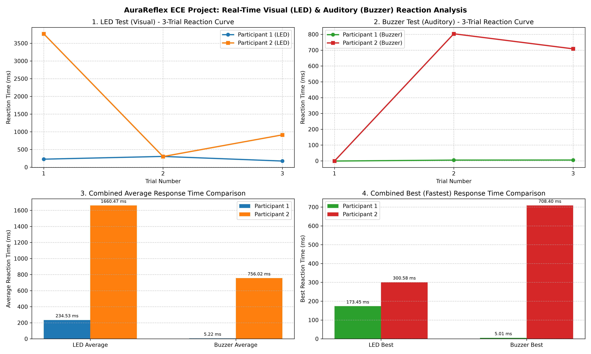

# AuraReflex: Real-Time Visual (LED) & Auditory (Buzzer) Reaction Time Analyzer

**Author:** S. Uday Kumar  
**Amrita Vishwa Vidyapeetham, Amritapuri Campus**

---

## 📌 Project Overview
**AuraReflex** is a real-time, dual-channel reaction-time measurement system engineered using an **ESP32 microcontroller (C++ / PlatformIO)** and a **Python desktop analytics application (pyserial, 
umpy, matplotlib)**. The system presents controlled visual (Red LED) or auditory (2.5 kHz Buzzer) stimuli, timestamps human button responses in microseconds with digital noise filtering, and streams UART telemetry at 115200 baud for automated CSV logging and 4-panel visualization.

---

## 📊 Experimental Results & 4-Panel Analysis
Across 12 trials (2 participants × 2 stimuli × 3 trials each), auditory reaction times were **3.8× to 4.7× faster** than visual reaction times:

| Metric | Participant 1 | Participant 2 |
| :--- | :--- | :--- |
| **LED Average (Visual)** | 3698.36 ms | 4765.75 ms |
| **Buzzer Average (Auditory)** | 782.71 ms | 1248.18 ms |
| **LED Best (Fastest)** | 1601.28 ms | 1937.08 ms |
| **Buzzer Best (Fastest)** | 281.89 ms | **270.17 ms (Project Record)** |

---

## ⚙️ Hardware Pin Configuration (ESP32)
* **Visual Stimulus (Red LED + Series Resistor):** GPIO 25 / GPIO 13 → Common Ground (GND)
* **Auditory Stimulus (2-Pin Passive Buzzer):** GPIO 26 (2.5 kHz square wave) → Common Ground (GND)
* **Channel 1 Push Button:** GPIO 32 (INPUT_PULLUP) → Common Ground (GND)
* **Channel 2 Push Button:** GPIO 33 (INPUT_PULLUP) → Common Ground (GND)

---

## 📂 Repository Structure
* Firmware_ESP32/Firmware_ESP32/src/main.cpp — ESP32 real-time C++ firmware (5s countdown, 7.0s continuous active window, 5ms digital debounce filter)
* 
eflex_app.py — Python UART telemetry controller, auto-flasher, CSV logger, and 4-panel Matplotlib dashboard generator
* Session_Exports/ — Exported .csv datasets and 300-DPI 4-panel .png graphs
